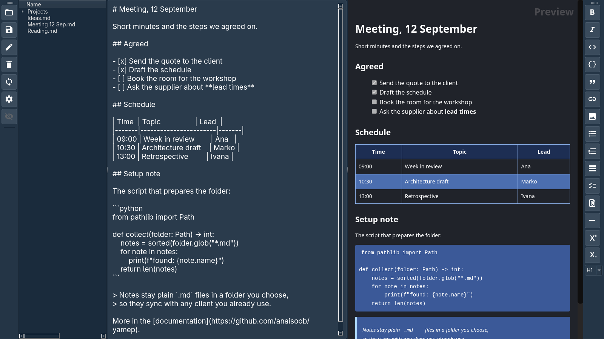
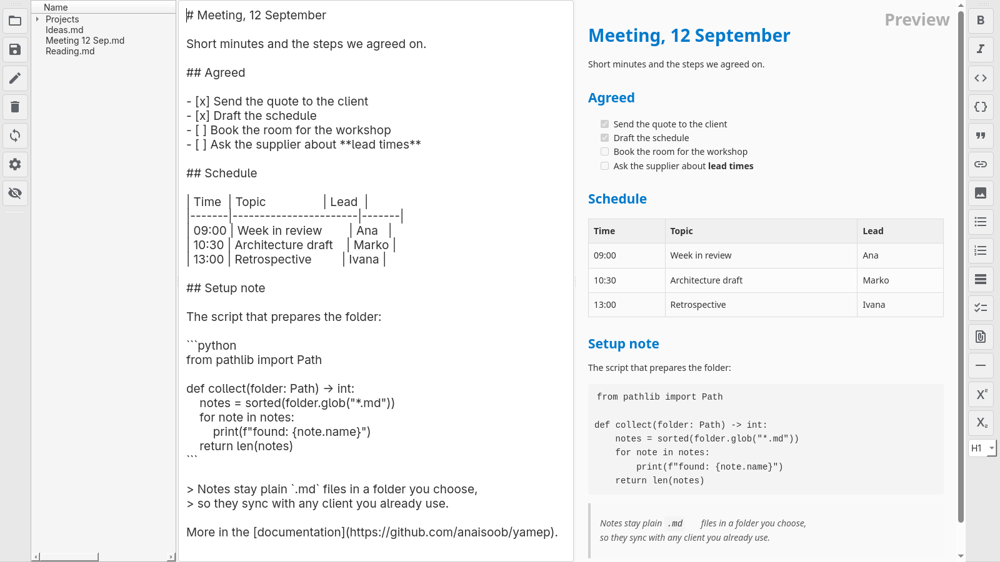
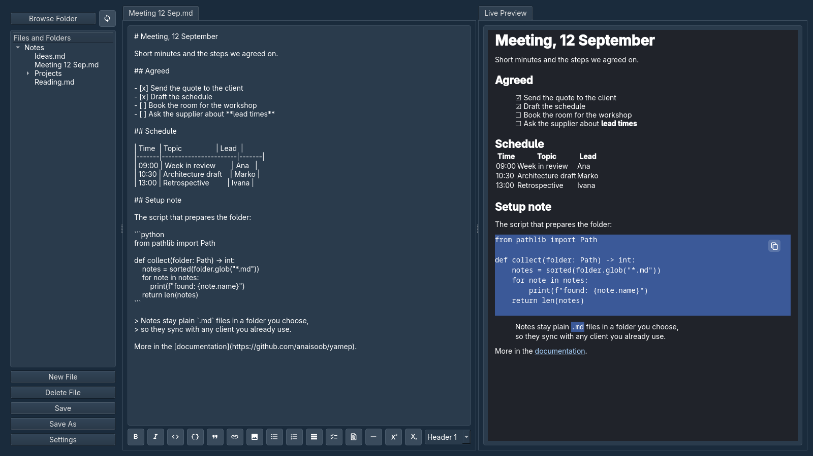
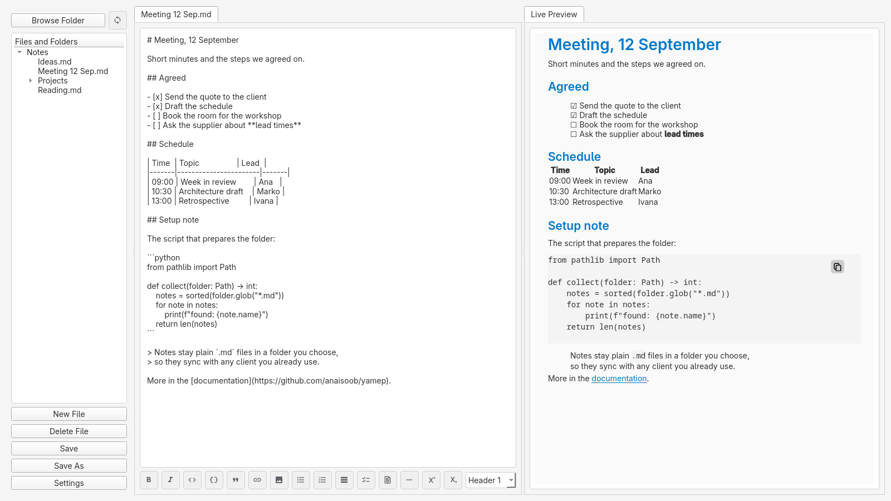

# Yamep

**Y**et **A**nother **M**arkdown **E**ditor & **P**review — a Qt desktop editor
that keeps your notes as plain Markdown files in a folder you choose.

Nothing is stored in a database or a proprietary format, so the notes stay
readable without Yamep and work with any file sync client (Nextcloud,
Syncthing, or none at all).



## Two variants

Yamep comes in two builds that share the same editor, file tree and themes, and
differ in how the preview is rendered.

| | Yamep | Yamep Lite |
|---|---|---|
| Preview | QtWebEngine | Qt's own rich text |
| Rendering fidelity | full CSS, syntax highlighting | simpler, but no browser engine |
| Images in the preview | rendered inline | shown as links that open a viewer |
| Installed size (Flatpak) | 407 MB | **117 MB** |
| Flatpak bundle | 119 MB | **23 MB** |
| Application ID | `io.github.itstomsh.yamep` | `io.github.itstomsh.yamep.lite` |
| Command | `yamep` | `yamep-lite` |

Take Lite if you want a small, quick editor without a browser engine. Take the
full build if you want images and the more faithful preview.

## Features

- Live preview next to the editor, vertically or side by side
- Toolbar for headings, lists, tables, code blocks, links, images, task lists,
  footnotes, super- and subscript
- File tree for the folder you are working in, which reopens the folders you
  had expanded
- Tables, fenced code with syntax highlighting, task lists with checkboxes,
  footnotes, strikethrough and insert marks
- Copy button on every code block
- Task lists you can tick in the preview: the checkbox edits the line it came
  from, as one undoable change
- Scroll sync anchored to source lines, so an image or a large heading cannot
  push the two panes apart
- Light, dark, blue, and a theme that follows the system
- Opens a file given on the command line, so `.md` files can be opened with
  Yamep straight from a file manager

### Notes that survive a sync client

Notes often live in a folder something else is writing to. Yamep handles that:

- **Saves are atomic.** The text goes to a temporary file that is then renamed
  over the note, so a sync client never uploads a half-written file. File
  permissions are kept, and a symlinked note stays a symlink.
- **Changes made on disk are noticed.** If a note changes while it is open and
  you have no unsaved edits, it is reloaded; if you do have edits, Yamep asks
  which version to keep. Reloading is undoable.
- **A deleted note is not lost.** If the file disappears while it is open, the
  text stays in the editor and the document is marked modified, so closing
  offers to save it again.

## Screenshots

| | |
|---|---|
|  |  |
| Yamep, blue theme | Yamep, light theme |
|  |  |
| Yamep Lite, blue theme | Yamep Lite, light theme |

## Install

### Flatpak

Needs `flatpak` and `flatpak-builder`. The first build downloads the KDE
runtime and the PySide base application, a few hundred megabytes.

```bash
git clone https://github.com/itstomsh/yamep.git
cd yamep
./build-flatpak.sh both --install
flatpak run io.github.itstomsh.yamep
```

`./build-flatpak.sh` takes `full`, `lite` or `both`, plus `--install` to install
the result and `--no-bundle` to skip writing the `.flatpak` bundle. Each variant
picks its own packaging metadata inside the build sandbox, so the two can be
built in any order.

### From source

Python 3.9 or newer, and PySide6, Markdown, pymdown-extensions and platformdirs.
With [uv](https://docs.astral.sh/uv/), which creates `.venv` from `uv.lock` on the
first run:

```bash
git clone https://github.com/itstomsh/yamep.git
cd yamep
uv run ./run-full      # or: uv run ./run-lite
```

Without uv, install the packages above yourself and run `./run-full` or `./run-lite`.
`uv run ./build-full.sh` and `uv run ./build-lite.sh` build the wheels with the
`build` package from the `dev` dependency group.

To install the full variant and get the `yamep` command:

```bash
pip install .
yamep --setup-desktop     # optional: add a menu entry and icon
```

The Lite variant is built the same way after swapping in its packaging
metadata, which `./build-lite.sh` does for you (it needs the `build`
package); the wheel lands in `dist/`.

## Configuration

Settings live in `~/.config/yamep/` when Yamep runs from source, and under
`~/.var/app/<application id>/config/yamep/` when it runs as a Flatpak. Each
variant keeps its own file, so the two do not fight over window size or theme.

## Development

```
yamep/core/     shared code: config, file safety, Markdown extensions, line anchors
yamep/full/     the QtWebEngine variant
yamep/lite/     the Qt rich text variant
flatpak/        Flatpak manifests, desktop entries, AppStream metadata, icons
```

`build-full.sh` and `build-lite.sh` build a wheel and an sdist for one variant
each, into `dist/`.

This project was developed with assistance from AI tools, including Claude
(Anthropic), for parts of the code, bug fixing and packaging.

## License

GPL-3.0-or-later. See [LICENSE](LICENSE).

The toolbar icons are Google's [Material Symbols](https://fonts.google.com/icons),
used unmodified under the Apache License 2.0; its text is in
[LICENSES/Apache-2.0.txt](LICENSES/Apache-2.0.txt).

Licensing is declared per file following the [REUSE](https://reuse.software)
specification, so `reuse lint` can check it.
